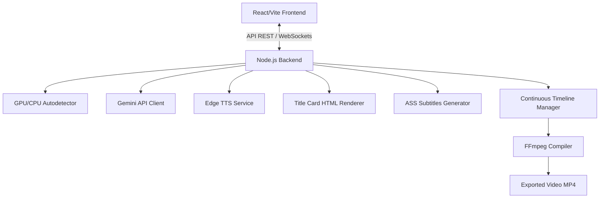

# Plan: Plataforma de Generación de Contenido Automático (Historias de Reddit)

Este plan detalla el diseño y la implementación de una plataforma local de generación de videos automáticos basados en historias de Reddit. El sistema utiliza **React/Vite con Tailwind CSS v4** para la interfaz de usuario, y un servidor local **Node.js/Express** para interactuar con hardware, la API de Gemini, generar audios, subtítulos sincronizados animadamente, y compilar los videos usando **FFmpeg**.

---

## User Review Required

> [!IMPORTANT]
> **Hardware de Renderizado y Dependencias Locales**
> 1. **FFmpeg**: El sistema requiere que tengas `ffmpeg` instalado en tu sistema y configurado en las variables de entorno de Windows. El backend autodetectará la gráfica para usar aceleración por hardware (`h264_nvenc` para NVIDIA, `h264_amf` para AMD, o CPU si no hay).
> 2. **Puppeteer**: Para generar la tarjeta de Reddit (Title Card) con fidelidad pixel-perfect (incluyendo emojis, fuentes de Reddit, bordes redondeados y sombras), utilizaremos un navegador headless ligero (`puppeteer-core` que usará tu instalación de Chrome local o descargará un Chromium local) para renderizar la plantilla HTML y guardarla como PNG.
> 3. **Fuentes tipográficas**: Se configurarán fuentes modernas en el archivo `.ass` de subtítulos (como Arial Bold, Montserrat o Impact) para asegurar animaciones de texto fluidas y profesionales.

---

## Open Questions

> [!NOTE]
> No hay preguntas abiertas bloqueantes ya que definimos los pilares de la arquitectura en la fase `/grill-me`. Cualquier ajuste menor o de diseño adicional se puede refinar en el panel interactivo de la interfaz web una vez implementada.

---

## Proposed Changes

El proyecto se estructurará con un frontend en React (Vite) y un backend en Node.js, todo dentro del directorio de tu espacio de trabajo `c:\Users\leonardoo\Desktop\redit`.



### Backend: Node.js (Servidor Local)

El backend manejará la lógica pesada del sistema: acceso a archivos, llamadas a la API de Gemini, conversión a voz (TTS), generación de imágenes de tarjetas de título, escritura de archivos de subtítulos `.ass`, y compilación final usando FFmpeg.

#### [NEW] [package.json](file:///c:/Users/leonardoo/Desktop/redit/package.json)
Define las dependencias compartidas o de la raíz para arrancar tanto el backend como el frontend.

#### [NEW] [server.js](file:///c:/Users/leonardoo/Desktop/redit/server.js)
El punto de entrada del backend de Node.js. 
- **Detección de Gráfica (GPU)**: Al iniciar, ejecutará un comando del sistema (como `wmic path win32_VideoController get name` en Windows) para identificar si tienes una tarjeta NVIDIA (`NVENC`), AMD (`AMF`), Intel (`QSV`) o si debe renderizar por CPU.
- **API REST**: Endpoints para:
  - `/api/detect-hardware`: Retorna la GPU activa detectada.
  - `/api/profiles`: Guarda/Carga perfiles de API (Gemini API keys, modelos, prompts por defecto).
  - `/api/templates`: Guarda/Carga plantillas de video (voces, colores, fuentes, animaciones, tarjeta de Reddit).
  - `/api/background-videos`: Escanea la carpeta seleccionada y devuelve la duración total y el estado de la línea de tiempo.
  - `/api/generate`: Inicia la cola de renderizado de videos en segundo plano. Retorna progreso en tiempo real mediante Server-Sent Events (SSE) o WebSockets.
  - `/api/export-path`: Guarda la ruta de salida por defecto (como un editor de video).

#### [NEW] [services/gemini.js](file:///c:/Users/leonardoo/Desktop/redit/services/gemini.js)
Módulo encargado de comunicarse con Gemini.
- Fuerza el modo JSON mediante el `responseSchema` de Gemini para asegurar que la historia contenga:
  ```json
  {
    "title": "Título llamativo de la historia",
    "content": "Cuerpo completo de la historia de Reddit...",
    "gender": "male" | "female"
  }
  ```
- **Documentación integrada**: Incluye comentarios extensos explicando cómo funciona el prompt de clasificación de género y cómo alterarlo si es necesario.

#### [NEW] [services/tts.js](file:///c:/Users/leonardoo/Desktop/redit/services/tts.js)
Módulo que interactúa con Microsoft Edge TTS.
- Descarga el audio generado para el título y el cuerpo.
- **Sincronización palabra por palabra**: Extrae los metadatos de tiempo exactos (timestamps) de cuándo se pronuncia cada palabra y los guarda en un archivo estructurado para que el generador de subtítulos los formatee.

#### [NEW] [services/cardRenderer.js](file:///c:/Users/leonardoo/Desktop/redit/services/cardRenderer.js)
Módulo que genera la imagen de la tarjeta de Reddit.
- Toma la plantilla HTML/CSS (con soporte para Light/Dark mode, foto de perfil personalizada, nombre de usuario, subreddit, votos y comentarios).
- Ajusta dinámicamente la altura según el largo del título.
- Utiliza un headless browser para hacer una captura ultrarrápida del elemento HTML y guardarla como PNG transparente.

#### [NEW] [services/subtitles.js](file:///c:/Users/leonardoo/Desktop/redit/services/subtitles.js)
Generador de archivos de subtítulos Advanced SubStation Alpha (`.ass`).
- Define los estilos globales (fuente, tamaño, contorno, sombra, márgenes).
- Escribe las marcas de tiempo para cada palabra.
- Implementa los preajustes de animación mediante marcas ASS:
  - **TikTok Pop**: Cada palabra activa aumenta de escala temporalmente (`\fscx120\fscy120`) y cambia a color amarillo brillante, mientras las demás permanecen en blanco de tamaño estándar.
  - **Smooth Highlight**: Transición de color suave cuando el audio avanza (tipo karaoke).
  - **Clean Fade**: Bloques de texto pequeños con difuminación suave en los bordes de tiempo.

#### [NEW] [services/timeline.js](file:///c:/Users/leonardoo/Desktop/redit/services/timeline.js)
Gestor de la pista de fondo continua.
- Escanea los videos de fondo locales del usuario y mantiene un estado persistente (`timeline.json`).
- Registra el archivo actual y el segundo exacto donde terminó el último video generado.
- Si el video actual expira en mitad de una historia, genera una lista de segmentos de FFmpeg para concatenar el final del video actual con el inicio del siguiente de manera imperceptible.
- Si se acaban todos los videos del directorio, reinicia la pista virtual desde el minuto 0 del primer video.

#### [NEW] [services/ffmpeg.js](file:///c:/Users/leonardoo/Desktop/redit/services/ffmpeg.js)
Módulo encargado de invocar FFmpeg.
- Construye el comando de renderizado:
  1. Recorta el video de fondo en el intervalo calculado por el `timeline.json`.
  2. Superpone la tarjeta de Reddit PNG durante la duración exacta del audio del título.
  3. Inserta los audios combinados (Título + Historia).
  4. Quema los subtítulos `.ass` encima del video.
  5. Codifica el archivo final a la ruta seleccionada usando aceleración GPU (si está disponible) y lo nombra con el título de la historia.

---

### Frontend: React (Vite + Tailwind CSS v4)

Una interfaz visual moderna y premium en modo oscuro con acentos de color vibrantes, menús fluidos y previsualizaciones en vivo.

#### [NEW] [frontend/index.html](file:///c:/Users/leonardoo/Desktop/redit/frontend/index.html)
Archivo HTML principal con fuentes tipográficas cargadas (Inter y Montserrat).

#### [NEW] [frontend/src/main.jsx](file:///c:/Users/leonardoo/Desktop/redit/frontend/src/main.jsx)
Punto de entrada de React.

#### [NEW] [frontend/src/index.css](file:///c:/Users/leonardoo/Desktop/redit/frontend/src/index.css)
Configuración de Tailwind CSS v4 con variables CSS personalizadas para crear efectos de desenfoque (glassmorphism) y transiciones animadas premium.

#### [NEW] [frontend/src/App.jsx](file:///c:/Users/leonardoo/Desktop/redit/frontend/src/App.jsx)
Contenedor principal con diseño de panel dividido (Sidebar de navegación + Contenido dinámico).

#### [NEW] [frontend/src/components/Dashboard.jsx](file:///c:/Users/leonardoo/Desktop/redit/frontend/src/components/Dashboard.jsx)
Panel principal donde se inicia la creación:
- Caja de prompt base.
- Selección rápida de plantilla y perfil de IA.
- Contador de videos a generar en fila.
- Botón premium animado "Comenzar Generación Automática".
- Sección de progreso en tiempo real que muestra el estado de cada etapa (Script -> Voz -> Tarjeta -> Subtítulos -> FFmpeg Render) con barras de progreso animadas.

#### [NEW] [frontend/src/components/CardPreview.jsx](file:///c:/Users/leonardoo/Desktop/redit/frontend/src/components/CardPreview.jsx)
Visualizador interactivo de la tarjeta de Reddit. Muestra en vivo los cambios en el avatar, nombre de usuario, subreddit, modo claro/oscuro, y simula cómo se estirará el contenedor según el título de prueba.

#### [NEW] [frontend/src/components/TemplateEditor.jsx](file:///c:/Users/leonardoo/Desktop/redit/frontend/src/components/TemplateEditor.jsx)
Editor completo de plantillas guardables:
- **Ajustes de Voz**: Selector de voces de Edge TTS para voz masculina y femenina.
- **Ajustes de Subtítulos**: Fuente, colores activo/pasivo, tamaño de letra, y animación activa (TikTok Pop, etc.).
- **Ajustes de Tarjeta**: Inputs para configurar la cabecera por defecto del card.

#### [NEW] [frontend/src/components/Settings.jsx](file:///c:/Users/leonardoo/Desktop/redit/frontend/src/components/Settings.jsx)
Página para configurar:
- API Keys de Inteligencia Artificial (Gemini, OpenAI opcional).
- Rutas de carpetas locales (videos de fondo, ruta de exportación final).
- Visor de hardware activo (muestra la GPU autodetectada y el estado de FFmpeg).

---

## Verification Plan

### Automated & Manual Verification
Para validar el sistema completo realizaremos las siguientes pruebas de calidad:

1. **Detección de Hardware**:
   - Iniciar el servidor local de Express y comprobar en la pestaña "Ajustes" que la gráfica (NVIDIA, AMD o CPU) ha sido identificada correctamente y que FFmpeg está disponible.
2. **Generación con Gemini**:
   - Disparar una prueba de guion en la pestaña de generación con un prompt como *"Historias graciosas de Reddit sobre vecinos"* y validar que retorna el JSON exacto con las llaves `title`, `content` y `gender` clasificando el género narrativo.
3. **Conversión de Voz y Sincronización**:
   - Comprobar que el archivo de audio se descarga correctamente y que el generador de subtítulos `.ass` contiene las marcas de tiempo palabra por palabra basadas en los timestamps del servicio Edge TTS.
4. **Prueba de Renderizado de Video**:
   - Ejecutar la generación de un video completo de prueba.
   - Verificar en la carpeta de exportación que el video final:
     - Tenga el fondo recortado en el offset correcto.
     - Superponga el card de Reddit al inicio exactamente durante la duración de la lectura del título.
     - Muestre los subtítulos animados (por ejemplo, estilo TikTok Pop) sincronizados palabra por palabra a partir del segundo en que finaliza el card.
     - Esté nombrado con el título de la historia.
5. **Prueba de Cola y Continuidad**:
   - Generar un lote de 3 videos.
   - Comprobar que el segundo video inicia su fondo exactamente donde terminó el primero.
   - Forzar un bucle agotando los videos de fondo y validar que regresa limpiamente al minuto 0 del primer video sin romper el proceso de renderizado.
